# Entity Relationship Diagram (ERD)

## BuyaLater — Koperasi Simpan Pinjam Digital untuk Anggota

Diagram ini mencakup **seluruh model database** (Tahap 1 sampai 13, 40 tabel; tahap 10B–10D hanya mengubah tampilan, tahap 11A menambah 5 tabel dan beberapa kolom, tahap 11B menambah 5 tabel (KYC, akad, restrukturisasi, SHU), tahap 13 menambah 4 tabel (`HariLibur`, `LogPenagihan`, `PersetujuanData`, `Pengaduan`) serta mengubah `Pengaturan` dan `Pinjaman`) dan dihasilkan langsung dari [prisma/schema.prisma](../prisma/schema.prisma). Tahap 14 (login Google/Apple, tampilan mobile) **tidak mengubah skema**: login sosial memakai sesi JWT dan mencocokkan email penyedia dengan `User.email`, tanpa tabel akun OAuth. Kunci: `PK` primary key, `FK` foreign key, `UK` unique. Notasi relasi Mermaid: `||` tepat satu, `|o` nol atau satu, `o{` nol atau banyak.

```mermaid
erDiagram
    User ||--o| Anggota : "userId"
    Anggota ||--o{ LogPenagihan : "anggotaId"
    User ||--o{ LogPenagihan : "dikirimOlehId"
    User ||--o{ PersetujuanData : "userId"
    Anggota ||--o{ Pengaduan : "anggotaId"
    Pinjaman |o--o{ Pengaduan : "pinjamanId"
    User ||--o{ Pengaduan : "ditanganiOlehId"
    Anggota ||--o{ Simpanan : "anggotaId"
    Anggota ||--o{ Penarikan : "anggotaId"
    Anggota ||--o{ Pinjaman : "anggotaId"
    Anggota ||--o{ RekeningAnggota : "anggotaId"
    Pinjaman ||--o| Pencairan : "pinjamanId"
    RekeningAnggota ||--o{ Pencairan : "rekeningAnggotaId"
    User ||--o{ Pencairan : "diprosesOlehId"
    Pinjaman ||--o{ Angsuran : "pinjamanId"
    Angsuran ||--o{ Pembayaran : "angsuranId"
    Anggota ||--o{ Pembayaran : "anggotaId"
    RekeningKoperasi ||--o{ Pembayaran : "rekeningKoperasiId"
    User |o--o{ Pembayaran : "diverifikasiOlehId"
    User ||--o{ Notifikasi : "userId"
    Angsuran |o--o{ Notifikasi : "angsuranId"
    Anggota ||--o{ Mutasi : "anggotaId"
    Anggota ||--o{ BerkasPrivat : "anggotaId"
    User ||--o{ PasswordResetToken : "userId"
    User |o--o{ Pinjaman : "dibuatOlehId"
    User |o--o{ Pinjaman : "disetujuiOlehId"
    Anggota ||--o{ VerifikasiAnggota : "anggotaId"
    User |o--o{ VerifikasiAnggota : "diverifikasiOlehId"
    Pinjaman ||--o| AkadPinjaman : "pinjamanId"
    Pinjaman ||--o{ Restrukturisasi : "pinjamanId"
    User |o--o{ Restrukturisasi : "diprosesOlehId"
    PeriodeShu ||--o{ ShuAnggota : "periodeId"
    Anggota ||--o{ ShuAnggota : "anggotaId"

    User {
        string id PK
        string nama
        string email UK
        string password
        Role role "ADMIN|MANAJER|TELLER|ANGGOTA, default ANGGOTA"
        datetime createdAt
    }

    Anggota {
        string id PK
        string userId FK,UK
        string noAnggota UK
        string nik UK
        string alamat
        string noHp
        datetime tanggalMasuk
        StatusAnggota status "default AKTIF"
        string foto "nullable"
        string fotoKtp "nullable"
        StatusVerifikasi statusVerifikasi "default PENDING"
        string catatanVerifikasi "nullable"
        datetime diverifikasiPada "nullable"
        datetime deletedAt "nullable, soft delete"
        datetime ditutupPada "nullable, penutupan akun oleh anggota"
    }

    Simpanan {
        string id PK
        string anggotaId FK
        JenisSimpanan jenis
        decimal jumlah "15,2"
        datetime tanggal
        string keterangan "nullable"
    }

    Penarikan {
        string id PK
        string anggotaId FK
        decimal jumlah "15,2"
        datetime tanggal
        StatusPenarikan status "default PENDING"
    }

    Pinjaman {
        string id PK
        string anggotaId FK
        decimal jumlah "15,2"
        int tenorBulan
        decimal bungaPersen "5,2, bunga nominal PER TAHUN"
        MetodeBunga metodeBunga "FLAT|MENURUN|ANUITAS, default FLAT"
        decimal biayaAdmin "15,2, maks 1% pokok, dipotong saat pencairan"
        decimal totalBayar "15,2"
        StatusPinjaman status "default DIAJUKAN"
        datetime tanggalPengajuan
        datetime tanggalDisetujui "nullable"
        string alasan "nullable"
        string dibuatOlehId FK "nullable, user penginput"
        string disetujuiOlehId FK "nullable, user penyetuju"
    }

    RekeningAnggota {
        string id PK
        string anggotaId FK
        string namaBank
        string noRekening
        string atasNama
        boolean isUtama "default false"
        datetime createdAt
    }

    RekeningKoperasi {
        string id PK
        string namaBank
        string noRekening
        string atasNama
        boolean isAktif "default true"
    }

    Pencairan {
        string id PK
        string pinjamanId FK,UK
        string rekeningAnggotaId FK
        decimal jumlahDicairkan "15,2"
        decimal biayaAdmin "15,2, default 0"
        datetime tanggalPencairan
        string buktiTransferUrl "nullable"
        string diprosesOlehId FK
        string catatan "nullable"
    }

    Angsuran {
        string id PK
        string pinjamanId FK
        int angsuranKe
        decimal jumlah "15,2"
        decimal denda "15,2, default 0"
        datetime tanggalJatuhTempo
        datetime tanggalBayar "nullable"
        StatusAngsuran status "default BELUM"
        int kodeUnik "3 digit, default 0"
        decimal terbayar "15,2, default 0"
    }

    Pembayaran {
        string id PK
        string angsuranId FK
        string anggotaId FK
        string rekeningKoperasiId FK
        decimal jumlahBayar "15,2"
        decimal dendaDibayar "15,2, default 0"
        string buktiBayarUrl
        datetime tanggalBayar
        StatusPembayaran status "default MENUNGGU"
        string alasanTolak "nullable"
        string diverifikasiOlehId FK "nullable"
        datetime tanggalVerifikasi "nullable"
        int kodeUnik
        decimal jumlahTagihan "15,2, sisa + denda + kode unik"
        decimal jumlahTransfer "15,2, diklaim anggota"
        decimal kelebihan "15,2, masuk simpanan sukarela"
        string hashBukti UK "SHA-256 file bukti, nullable"
        boolean isPelunasan "default false"
    }

    Galeri {
        string id PK
        string judul
        string deskripsi "nullable"
        string gambarUrl
        string kategori
        datetime createdAt
        datetime deletedAt "nullable, soft delete"
    }

    Artikel {
        string id PK
        string judul
        string slug UK
        string isi
        string gambarUrl "nullable"
        datetime createdAt
        datetime deletedAt "nullable, soft delete"
    }

    Pesan {
        string id PK
        string nama
        string email
        string subjek
        string isi
        datetime createdAt
    }

    Pengaturan {
        string id PK
        decimal bungaPinjamanPerTahun "5,2, default 12, maks 24 efektif"
        decimal bungaSimpananPerTahun "5,2, default 4, maks 9"
        MetodeBunga metodeBunga "default ANUITAS"
        decimal biayaAdminPersen "5,2, default 1, maks 1"
        decimal simpananPokok "15,2"
        decimal simpananWajib "15,2"
        decimal dendaPersenPerHari "5,2, default 0.05"
        int masaTenggangHari "default 3"
        text templatePengingat "nullable, bebas kata terlarang"
        int hariPengingatSebelumJatuhTempo "default 3"
        int batasHariTerlambatKritis "default 30"
        string namaInstansi
        string deskripsiFooter "nullable"
        string emailCs "nullable"
        string teleponCs "nullable"
        string whatsappCs "nullable"
        string alamatPusat "nullable"
        decimal batasPencairanManajer "15,2, default 10000000"
        decimal minPinjaman "15,2, default 1000000"
        decimal maksPinjaman "15,2, default 50000000"
        decimal minTransaksi "15,2, default 10000"
        decimal maksTransaksi "15,2, default 100000000"
        int minLamaAnggotaBulan "default 3"
        decimal plafonKaliSimpanan "5,2, default 3"
        decimal maksRasioAngsuranPersen "5,2, default 30"
        int maksHariTunggakan "default 30"
        int periodeTunggakanBulan "default 12"
        decimal batasDendaPersen "5,2, default 10"
    }

    Notifikasi {
        string id PK
        string userId FK
        string angsuranId FK "nullable"
        string judul
        string pesan
        TipeNotifikasi tipe "default INFO"
        string link "nullable"
        boolean sudahDibaca "default false"
        string emailStatus "nullable"
        datetime createdAt
    }

    Banner {
        string id PK
        string judul
        string subjudul "nullable"
        string gambarUrl
        string linkTujuan "nullable"
        string teksTombol "nullable"
        PosisiBanner posisi "default HERO"
        int urutan "default 0"
        boolean isAktif "default true"
        datetime tanggalMulai "nullable"
        datetime tanggalSelesai "nullable"
    }

    Testimoni {
        string id PK
        string nama
        string pekerjaan "nullable"
        string kota "nullable"
        string fotoUrl "nullable"
        string isi
        int rating "default 5"
        boolean isTampil "default true"
    }

    Mitra {
        string id PK
        string nama
        string logoUrl
        string website "nullable"
        string kategori "nullable"
        string deskripsi "nullable"
        int tahunBermitra "nullable"
        int urutan "default 0"
        TingkatMitra tingkat "default PENDUKUNG"
        boolean isUnggulan "default false"
        string kutipan "nullable"
        string namaPerwakilan "nullable"
        string jabatanPerwakilan "nullable"
        string warnaBrand "nullable"
        datetime deletedAt "nullable, soft delete"
    }

    Pencapaian {
        string id PK
        int tahun
        string judul
        string deskripsi
        string ikon
    }

    Keunggulan {
        string id PK
        string judul
        string deskripsi
        string ikon
        int urutan "default 0"
    }

    Subscriber {
        string id PK
        string email UK
        datetime createdAt
    }

    Penghargaan {
        string id PK
        string judul
        string pemberi
        int tahun
        string deskripsi "nullable"
        string ikon
        int urutan "default 0"
    }

    KantorCabang {
        string id PK
        string nama
        string alamat
        string kota
        string telepon "nullable"
        string jamOperasional "nullable"
        decimal latitude "10,7"
        decimal longitude "10,7"
        boolean isPusat "default false"
    }

    MediaSosial {
        string id PK
        PlatformSosial platform
        string url
        int urutan "default 0"
        boolean isAktif "default true"
    }

    MenuFooter {
        string id PK
        KolomFooter kolom
        string label
        string href
        int urutan "default 0"
    }

    MetodePembayaran {
        string id PK
        string nama
        string ikon
        int urutan "default 0"
    }

    Mutasi {
        string id PK
        string anggotaId FK
        JenisMutasi jenis
        ArahMutasi arah
        decimal jumlah "15,2"
        decimal saldoSetelah "15,2"
        string referensiId "nullable"
        string keterangan "nullable"
        datetime createdAt
    }

    AuditLog {
        string id PK
        string userId "nullable, tanpa FK"
        string aksi "CREATE|UPDATE|DELETE"
        string entitas
        string entitasId
        json dataLama "nullable"
        json dataBaru "nullable"
        string ipAddress "nullable"
        datetime createdAt
    }

    LoginAttempt {
        string id PK
        string email
        string ipAddress "nullable"
        boolean berhasil
        datetime createdAt
    }

    PasswordResetToken {
        string id PK
        string userId FK
        string tokenHash UK "SHA-256"
        datetime expiresAt "1 jam"
        datetime usedAt "nullable"
        datetime createdAt
    }

    BerkasPrivat {
        string id PK "UUID"
        KategoriBerkas kategori
        string anggotaId FK "pemilik"
        string namaFile
        string mime
        int ukuran
        string diunggahOlehId
        datetime createdAt
    }

    VerifikasiAnggota {
        string id PK
        string anggotaId FK
        string fotoKtpPath "/api/file/id"
        string swafotoKtpPath "/api/file/id"
        decimal penghasilanBulanan "15,2"
        string pekerjaan
        StatusKyc status "MENUNGGU|DITERIMA|DITOLAK"
        string alasanTolak "nullable"
        string diverifikasiOlehId FK "nullable"
        datetime tanggalVerifikasi "nullable"
        datetime createdAt
    }

    AkadPinjaman {
        string id PK
        string pinjamanId FK,UK
        text isiAkad "salinan akad saat disetujui"
        datetime disetujuiPada
        string ipAddress "nullable"
        string userAgent "nullable"
    }

    Restrukturisasi {
        string id PK
        string pinjamanId FK
        int tenorLama
        int tenorBaru
        string alasan
        StatusRestrukturisasi status "DIAJUKAN|DISETUJUI|DITOLAK"
        string diprosesOlehId FK "nullable"
        datetime createdAt
        datetime diprosesPada "nullable"
    }

    PeriodeShu {
        string id PK
        int tahun UK
        decimal totalShu "15,2"
        decimal persenJasaModal "5,2"
        decimal persenJasaPinjaman "5,2"
        StatusShu status "DRAFT|DIBAGIKAN"
        datetime dibagikanPada "nullable"
        datetime createdAt
    }

    ShuAnggota {
        string id PK
        string periodeId FK
        string anggotaId FK
        decimal jasaModal "15,2"
        decimal jasaPinjaman "15,2"
        decimal total "15,2"
    }

    HariLibur {
        string id PK
        date tanggal UK
        string keterangan
        datetime createdAt
    }

    LogPenagihan {
        string id PK
        string anggotaId FK
        string angsuranId "nullable, tanpa FK agar bukti tetap ada"
        SaluranPenagihan saluran "NOTIFIKASI|EMAIL|WHATSAPP|TELEPON"
        text isiPesan
        string dikirimOlehId FK "nullable, null = sistem otomatis"
        datetime waktuKirim
    }

    PersetujuanData {
        string id PK
        string userId FK
        JenisPersetujuan jenis "VERIFIKASI_IDENTITAS|PENILAIAN_KELAYAKAN|PENGIRIMAN_PENGINGAT"
        boolean disetujui
        string versiKebijakan
        datetime waktu
        string ipAddress "nullable"
    }

    Pengaduan {
        string id PK
        string anggotaId FK
        string pinjamanId FK "nullable"
        string nomorTiket UK
        KategoriPengaduan kategori "PINJAMAN|PENAGIHAN|SIMPANAN|LAYANAN|DATA"
        text isi
        string lampiranPath "nullable, /api/file/id"
        StatusPengaduan status "DITERIMA|DIPROSES|SELESAI"
        text tanggapan "nullable"
        string ditanganiOlehId FK "nullable"
        datetime createdAt
        datetime selesaiAt "nullable"
    }
```

## Pengelompokan tabel

| Kelompok | Tabel | Keterangan |
| --- | --- | --- |
| Akun & keanggotaan | `User`, `Anggota` | Login NextAuth, profil anggota, verifikasi KTP. |
| Simpanan | `Simpanan`, `Penarikan` | Simpanan pokok/wajib/sukarela dan pengajuan penarikan. |
| Pinjaman | `Pinjaman`, `Angsuran`, `Pencairan`, `Pembayaran` | Siklus pinjaman: pengajuan → pencairan → jadwal angsuran → pembayaran terverifikasi. |
| Rekening | `RekeningAnggota`, `RekeningKoperasi` | Rekening tujuan pencairan dan rekening tujuan pembayaran angsuran. |
| Notifikasi | `Notifikasi` | Notifikasi dalam aplikasi, sekaligus log pengingat/keterlambatan dan status email. |
| Konten publik | `Galeri`, `Artikel`, `Pesan`, `Banner`, `Testimoni`, `Mitra`, `Pencapaian`, `Keunggulan`, `Penghargaan`, `KantorCabang` | Dikelola admin; berdiri sendiri. |
| Tampilan footer | `MenuFooter`, `MediaSosial`, `MetodePembayaran` | Isi footer dinamis: menu per kolom, tautan media sosial, metode pembayaran. |
| Newsletter | `Subscriber` | Email pelanggan newsletter dari footer situs (email unik). |
| Keamanan & audit | `Mutasi`, `AuditLog`, `LoginAttempt`, `PasswordResetToken`, `BerkasPrivat` | Buku mutasi append-only, jejak audit, kunci login, reset password, dan metadata berkas privat. |
| Pinjaman lanjutan (11B) | `VerifikasiAnggota`, `AkadPinjaman`, `Restrukturisasi`, `PeriodeShu`, `ShuAnggota` | KYC, akad digital, perpanjangan tenor, dan pembagian SHU. |
| Koperasi close loop (13) | `HariLibur`, `LogPenagihan`, `PersetujuanData`, `Pengaduan` | Hari libur penagihan, bukti penagihan beretika, persetujuan data pribadi (UU PDP), dan pengaduan anggota. |
| Konfigurasi | `Pengaturan` | Bunga pinjaman/simpanan per tahun, metode bunga, biaya admin, simpanan, parameter denda, masa tenggang, template pengingat, serta identitas & kontak situs (nama instansi, deskripsi footer, email/telepon/WhatsApp CS, alamat pusat). |

> Tabel yang **tidak memiliki relasi foreign key** (berdiri sendiri): `Galeri`, `Artikel`, `Pesan`, `Pengaturan`, `RekeningKoperasi` (hanya direferensikan oleh `Pembayaran`), serta tabel konten Tahap 9B: `Banner`, `Testimoni`, `Mitra`, `Pencapaian`, `Keunggulan`, `Subscriber`, `Penghargaan`, `KantorCabang`, `MenuFooter`, `MediaSosial`, `MetodePembayaran`. Tabel Tahap 9B–10A sengaja tidak berelasi ke `Anggota`; `Testimoni.nama` adalah teks bebas.

## Catatan desain

- **Berkas** (sebelum 11A; berkas sensitif kini privat, lihat Catatan keamanan): `Anggota.foto`, gambar `Galeri`/`Artikel`/`Banner`/`Testimoni`/`Mitra`, `Pencairan.buktiTransferUrl`, dan `Pembayaran.buktiBayarUrl` disimpan sebagai file publik di `public/uploads/` (atau URL eksternal). `Anggota.fotoKtp` disimpan privat di `storage/ktp/` dan hanya dapat diakses lewat `/api/anggota/[id]/ktp` setelah pemeriksaan sesi (pemilik data atau admin).
- **Pencairan** bersifat 1:0..1 terhadap `Pinjaman`. Saat dibuat, status pinjaman menjadi `DICAIRKAN` dan jadwal `Angsuran` dibentuk (jatuh tempo pertama 1 bulan setelah tanggal pencairan).
- **Pembayaran** 1:N terhadap `Angsuran` (beberapa percobaan jika sebelumnya `DITOLAK`). Saat dibuat, `Angsuran.status` menjadi `MENUNGGU_VERIFIKASI`. Admin menerima (`Angsuran` → `LUNAS`, `Pinjaman` → `LUNAS` jika semua angsuran lunas) atau menolak (kembali ke `BELUM`/`TERLAMBAT`).
- **Denda & pengingat**: `cekJatuhTempo()` (cron harian 08.00 atau tombol admin) mengubah angsuran yang lewat jatuh tempo menjadi `TERLAMBAT`, menghitung `Angsuran.denda = sisa angsuran × Pengaturan.dendaPersenPerHari% × (hari terlambat − masa tenggang)`, dan membuat `Notifikasi` bertipe `PENGINGAT`/`TERLAMBAT` (lihat Catatan Tahap 13 untuk jadwal dan batas pengingat). `Notifikasi` bertipe `INFO`/`PENCAIRAN`/`PEMBAYARAN` dibuat oleh aksi admin.
- **KantorCabang**: hanya satu kantor yang boleh `isPusat = true` (kantor lain otomatis dilepas); koordinat `latitude`/`longitude` dipakai embed OpenStreetMap di `/kantor-cabang`, dan jam operasional kantor pusat tampil di footer.
- **Footer dinamis**: `MenuFooter` (kolom `LAYANAN`/`PERUSAHAAN`/`BANTUAN`), `MediaSosial` (hanya yang `isAktif`), `MetodePembayaran`, dan kolom identitas di `Pengaturan` dibaca oleh `getSitus()`; bila kosong dipakai nilai bawaan di `src/lib/kontak.ts`. `MenuFooter.href` hanya boleh `/…` atau `https://…`.
- **Penghargaan** ditampilkan di halaman `/tentang`.
- **Subscriber** menyimpan email newsletter (unik); pendaftaran ulang dengan email yang sama tidak membuat baris baru.
- **Mitra** memiliki `tingkat` (`STRATEGIS`/`PENDUKUNG`), `kutipan`, perwakilan, dan `warnaBrand` (hex untuk aksen kartu). Hanya satu mitra yang boleh `isUnggulan = true` (disorot di `/mitra`): menyimpan mitra dengan sorotan otomatis melepas sorotan mitra lain. Mitra menyimpan logo (berkas SVG di `public/images/mitra/`), kategori, deskripsi singkat, dan tahun mulai bermitra; ditampilkan di beranda dan halaman `/mitra`.
- **Banner** (posisi `FOOTER`, `HERO`, `SIDEBAR`) tampil di situs hanya jika `isAktif = true` dan hari ini berada di antara `tanggalMulai` dan `tanggalSelesai` (nilai kosong = tanpa batas).
- `Pencapaian.ikon` dan `Keunggulan.ikon` berisi kunci ikon teks (mis. `piggy-bank`, `shield`), bukan relasi tabel.

## Catatan keamanan (Tahap 11A)

- **Uang**: seluruh kolom nominal `DECIMAL(15,2)` (persentase `DECIMAL(5,2)`); di aplikasi dihitung dengan `Decimal` (Prisma/decimal.js), bukan `Number`.
- **Mutasi**: append-only (aplikasi menolak update/delete). Saldo simpanan = Σ MASUK − Σ KELUAR untuk jenis `SIMPANAN`, `PENARIKAN`, `KOREKSI`; `PENCAIRAN`, `ANGSURAN`, `DENDA` dicatat sebagai arus kas dan tidak menggeser saldo simpanan. Koreksi = baris `KOREKSI`.
- **AuditLog**: append-only, sengaja tanpa foreign key. Dicatat untuk Pinjaman, Pencairan, Pembayaran, Simpanan, Penarikan, RekeningAnggota, Pengaturan (juga Angsuran, Anggota, User, Mutasi).
- **BerkasPrivat**: file di `storage/private/<kategori>/<uuid>.<ext>` (di luar `public/`), dilayani lewat `/api/file/[id]` hanya untuk pemilik atau staf berwenang. Kolom `Anggota.foto`, `Anggota.fotoKtp`, `Pencairan.buktiTransferUrl`, `Pembayaran.buktiBayarUrl` kini berisi `/api/file/<id>`.
- **Soft delete**: `deletedAt` pada `Anggota`, `Galeri`, `Artikel`, `Mitra`; baris yang dihapus disembunyikan dari semua pembacaan.
- **LoginAttempt**: dipakai mengunci login 15 menit setelah 5 kali gagal. **PasswordResetToken** menyimpan hash SHA-256 token (berlaku 1 jam, sekali pakai).

## Catatan pinjaman lanjutan (Tahap 11B)

- **Kelayakan** (`cekKelayakan`): KYC `DITERIMA`, anggota ≥ N bulan, tanpa pinjaman aktif lain, plafon = min(kelipatan × saldo simpanan, pinjaman maksimal), angsuran/bulan ≤ rasio × penghasilan, tanpa tunggakan > N hari dalam periode terakhir; semua angka di `Pengaturan`.
- **Akad**: pencairan hanya bisa bila `AkadPinjaman` ada; `isiAkad` menyimpan salinan teks sehingga tidak berubah walau pengaturan berubah.
- **Pembayaran**: `Angsuran.kodeUnik` (3 digit) ditambahkan ke nominal transfer; `Pembayaran.hashBukti` (SHA-256, unik) menolak bukti yang sama. Kurang bayar → `SEBAGIAN` dan `Angsuran.terbayar` bertambah (denda dilunasi lebih dulu); kelebihan (termasuk kode unik) menjadi `Simpanan` jenis `SUKARELA` + `Mutasi`.
- **Pelunasan dipercepat**: `Pembayaran.isPelunasan = true`, nominal = sisa pokok + bunga bulan berjalan + denda − yang sudah dibayar.
- **Denda**: total denda per pinjaman dibatasi `batasDendaPersen` × pokok.
- **Restrukturisasi**: saat disetujui Manajer, angsuran belum lunas dijadwal ulang (baris dipakai ulang agar riwayat pembayaran tidak hilang) dan `Pinjaman.tenorBulan` diganti.
- **SHU**: jasa modal sebanding saldo simpanan akhir tahun, jasa pinjaman sebanding bunga yang dibayar; saat `DIBAGIKAN` masuk sebagai `Simpanan` `SUKARELA` + `Mutasi`.

## Enum

| Enum | Nilai |
| --- | --- |
| `Role` | `ADMIN`, `MANAJER`, `TELLER`, `ANGGOTA` |
| `JenisMutasi` | `SIMPANAN`, `PENARIKAN`, `PENCAIRAN`, `ANGSURAN`, `DENDA`, `KOREKSI` |
| `ArahMutasi` | `MASUK`, `KELUAR` |
| `StatusKyc` | `MENUNGGU`, `DITERIMA`, `DITOLAK` |
| `StatusRestrukturisasi` | `DIAJUKAN`, `DISETUJUI`, `DITOLAK` |
| `StatusShu` | `DRAFT`, `DIBAGIKAN` |
| `KategoriBerkas` | `KTP`, `SWAFOTO`, `BUKTI_TRANSFER`, `BUKTI_BAYAR`, `PENGADUAN` |
| `MetodeBunga` | `FLAT`, `MENURUN`, `ANUITAS` |
| `SaluranPenagihan` | `NOTIFIKASI`, `EMAIL`, `WHATSAPP`, `TELEPON` |
| `JenisPersetujuan` | `VERIFIKASI_IDENTITAS`, `PENILAIAN_KELAYAKAN`, `PENGIRIMAN_PENGINGAT` |
| `KategoriPengaduan` | `PINJAMAN`, `PENAGIHAN`, `SIMPANAN`, `LAYANAN`, `DATA` |
| `StatusPengaduan` | `DITERIMA`, `DIPROSES`, `SELESAI` |
| `StatusAnggota` | `AKTIF`, `NONAKTIF` |
| `StatusVerifikasi` | `PENDING`, `TERVERIFIKASI`, `DITOLAK` |
| `JenisSimpanan` | `POKOK`, `WAJIB`, `SUKARELA` |
| `StatusPenarikan` | `PENDING`, `DISETUJUI`, `DITOLAK` |
| `StatusPinjaman` | `DIAJUKAN`, `DISETUJUI`, `DICAIRKAN`, `DITOLAK`, `LUNAS` |
| `StatusAngsuran` | `BELUM`, `MENUNGGU_VERIFIKASI`, `LUNAS`, `TERLAMBAT` |
| `StatusPembayaran` | `MENUNGGU`, `DITERIMA`, `DITOLAK`, `SEBAGIAN` |
| `TipeNotifikasi` | `PENGINGAT`, `TERLAMBAT`, `PENCAIRAN`, `PEMBAYARAN`, `INFO` |
| `PosisiBanner` | `HERO`, `FOOTER`, `SIDEBAR` |
| `TingkatMitra` | `STRATEGIS`, `PENDUKUNG` |
| `PlatformSosial` | `INSTAGRAM`, `FACEBOOK`, `YOUTUBE`, `TIKTOK`, `WHATSAPP` |
| `KolomFooter` | `LAYANAN`, `PERUSAHAAN`, `BANTUAN` |

## Kardinalitas relasi

Arah: tabel induk (sisi "1") → tabel anak (sisi FK).

| Relasi | Kardinalitas | Foreign key & aturan hapus |
| --- | --- | --- |
| `User` → `Anggota` | 1 : 0..1 | `userId`, `onDelete: Cascade` |
| `Anggota` → `Simpanan` | 1 : N | `anggotaId`, `onDelete: Cascade` |
| `Anggota` → `Penarikan` | 1 : N | `anggotaId`, `onDelete: Cascade` |
| `Anggota` → `Pinjaman` | 1 : N | `anggotaId`, `onDelete: Cascade` |
| `Anggota` → `RekeningAnggota` | 1 : N | `anggotaId`, `onDelete: Cascade` |
| `Pinjaman` → `Pencairan` | 1 : 0..1 | `pinjamanId`, `onDelete: Cascade` |
| `RekeningAnggota` → `Pencairan` | 1 : N | `rekeningAnggotaId`, `onDelete: Restrict` |
| `User` → `Pencairan` | 1 : N | `diprosesOlehId`, `onDelete: Restrict` |
| `Pinjaman` → `Angsuran` | 1 : N | `pinjamanId`, `onDelete: Cascade` |
| `Angsuran` → `Pembayaran` | 1 : N | `angsuranId`, `onDelete: Cascade` |
| `Anggota` → `Pembayaran` | 1 : N | `anggotaId`, `onDelete: Cascade` |
| `RekeningKoperasi` → `Pembayaran` | 1 : N | `rekeningKoperasiId`, `onDelete: Restrict` |
| `User` → `Pembayaran` | 1 : N | `diverifikasiOlehId` (opsional), `onDelete: SetNull` |
| `User` → `Notifikasi` | 1 : N | `userId`, `onDelete: Cascade` |
| `Angsuran` → `Notifikasi` | 1 : N | `angsuranId` (opsional), `onDelete: Cascade` |
| `Anggota` → `Mutasi` | 1 : N | `anggotaId`, `onDelete: Restrict` (anggota dengan mutasi tidak bisa dihapus permanen) |
| `Anggota` → `BerkasPrivat` | 1 : N | `anggotaId`, `onDelete: Cascade` |
| `User` → `PasswordResetToken` | 1 : N | `userId`, `onDelete: Cascade` |
| `User` → `Pinjaman` (penginput) | 1 : N | `dibuatOlehId` (opsional), `onDelete: SetNull` |
| `User` → `Pinjaman` (penyetuju) | 1 : N | `disetujuiOlehId` (opsional), `onDelete: SetNull` |
| `Anggota` → `VerifikasiAnggota` | 1 : N | `anggotaId`, `onDelete: Cascade` (status terbaru yang berlaku) |
| `User` → `VerifikasiAnggota` | 1 : N | `diverifikasiOlehId` (opsional), `onDelete: SetNull` |
| `Pinjaman` → `AkadPinjaman` | 1 : 0..1 | `pinjamanId` unik, `onDelete: Cascade` |
| `Pinjaman` → `Restrukturisasi` | 1 : N | `pinjamanId`, `onDelete: Cascade` |
| `User` → `Restrukturisasi` | 1 : N | `diprosesOlehId` (opsional), `onDelete: SetNull` |
| `PeriodeShu` → `ShuAnggota` | 1 : N | `periodeId`, `onDelete: Cascade`; unik (`periodeId`, `anggotaId`) |
| `Anggota` → `ShuAnggota` | 1 : N | `anggotaId`, `onDelete: Restrict` |
| `Anggota` → `LogPenagihan` | 1 : N | `anggotaId`, `onDelete: Cascade` |
| `User` → `LogPenagihan` | 1 : N | `dikirimOlehId` (opsional), `onDelete: SetNull` |
| `User` → `PersetujuanData` | 1 : N | `userId`, `onDelete: Cascade` |
| `Anggota` → `Pengaduan` | 1 : N | `anggotaId`, `onDelete: Cascade` |
| `Pinjaman` → `Pengaduan` | 1 : N | `pinjamanId` (opsional), `onDelete: SetNull` |
| `User` → `Pengaduan` | 1 : N | `ditanganiOlehId` (opsional), `onDelete: SetNull` |

## Indeks

- `User(role)`, unique `User(email)`
- `Anggota(status)`, `Anggota(statusVerifikasi)`, unique `Anggota(userId)`, unique `Anggota(noAnggota)`, unique `Anggota(nik)`
- `Simpanan(anggotaId, tanggal)`, `Simpanan(jenis)`
- `Penarikan(anggotaId, tanggal)`, `Penarikan(status)`
- `Pinjaman(anggotaId, status)`, `Pinjaman(tanggalPengajuan)`
- `RekeningAnggota(anggotaId)`
- `Pencairan(rekeningAnggotaId)`, unique `Pencairan(pinjamanId)`
- unique `Angsuran(pinjamanId, angsuranKe)`, `Angsuran(status, tanggalJatuhTempo)`
- `Pembayaran(angsuranId)`, `Pembayaran(anggotaId)`, `Pembayaran(status)`
- `Galeri(kategori)`, `Galeri(createdAt)`
- `Artikel(createdAt)`, unique `Artikel(slug)`
- `Pesan(createdAt)`
- `Notifikasi(userId, sudahDibaca, createdAt)`, `Notifikasi(angsuranId, createdAt)`, `Notifikasi(tipe, createdAt)`
- `Banner(posisi, isAktif, urutan)`
- `Testimoni(isTampil)`
- `Mitra(urutan)`
- `Pencapaian(tahun)`
- `Keunggulan(urutan)`
- `Subscriber(createdAt)`, unique `Subscriber(email)`
- `Penghargaan(tahun)`, `Penghargaan(urutan)`
- `KantorCabang(isPusat)`
- `MediaSosial(isAktif, urutan)`
- `MenuFooter(kolom, urutan)`
- `MetodePembayaran(urutan)`
- unique `HariLibur(tanggal)`
- `LogPenagihan(anggotaId, waktuKirim)`, `LogPenagihan(waktuKirim)`
- `PersetujuanData(userId, jenis)`
- unique `Pengaduan(nomorTiket)`, `Pengaduan(anggotaId, createdAt)`, `Pengaduan(status, createdAt)`

## Catatan koperasi close loop (Tahap 13)

- **Bunga per tahun**: `Pinjaman.bungaPersen` kini bunga nominal **per tahun** (data lama dikonversi ×12 oleh migrasi). `Pinjaman.metodeBunga` (FLAT/MENURUN/ANUITAS) menentukan jadwal cicilan; `Pinjaman.biayaAdmin` (maks. 1% pokok) dipotong saat pencairan. Bunga efektif per tahun = IRR arus kas (dana diterima vs cicilan) dan **ikut menghitung biaya admin**.
- **Batas regulasi** (divalidasi di server): bunga pinjaman efektif ≤ 24%/tahun pada tenor 3–24 bulan, bunga simpanan ≤ 9%, biaya admin ≤ 1%, total denda ≤ 10% pokok. Pesan penolakan: "Melebihi batas Permenkop UKM 8/2023".
- **Denda**: dari angsuran yang terlambat (bukan total pinjaman), baru setelah `masaTenggangHari`, bawaan 0,05%/hari.
- **Kelayakan** bertambah: anggota aktif & terverifikasi, simpanan pokok sudah dibayar, simpanan wajib tidak menunggak > 2 bulan (jendela 12 bulan penuh terakhir).
- **Penagihan beretika**: pengingat dari semua saluran hanya Senin–Sabtu 08.00–20.00 WIB di luar `HariLibur`, hanya ke anggota yang bersangkutan, maks. 1 per anggota per hari (dihitung dari `LogPenagihan`). Template (`Pengaturan.templatePengingat`) ditolak bila memuat kata terlarang. Tidak ada kolom kontak darurat.
- **PersetujuanData**: tiga baris per pendaftaran (identitas, kelayakan, pengingat) dengan versi kebijakan dan IP. **Anggota.ditutupPada**: penutupan akun setelah semua pinjaman lunas; saldo simpanan diajukan sebagai `Penarikan`.
- **Pengaduan**: target selesai 10 hari kerja (Senin–Jumat, di luar `HariLibur`); `lampiranPath` memakai `BerkasPrivat` kategori `PENGADUAN`.
- **Kesehatan koperasi** (dihitung, tanpa tabel): pokok pinjaman beredar ÷ total simpanan; kuning > 80%, merah > 90% (persetujuan pinjaman hanya Manajer).

Sumber acuan: [prisma/schema.prisma](../prisma/schema.prisma). SQL penambahan tabel Tahap 9B: [prisma/sql/9b-konten-publik.sql](../prisma/sql/9b-konten-publik.sql), [9d-subscriber.sql](../prisma/sql/9d-subscriber.sql), [9e-mitra-detail.sql](../prisma/sql/9e-mitra-detail.sql), [10a-mitra-footer-kantor.sql](../prisma/sql/10a-mitra-footer-kantor.sql). SQL Tahap 13: [13-koperasi-close-loop.sql](../prisma/sql/13-koperasi-close-loop.sql).

## Akun dan data contoh untuk pengujian

Bagian ini menjelaskan bagaimana data contoh (`prisma/seed.ts`) terhubung ke proses login supaya alurnya mudah ditelusuri.

**Alur login dan tabel yang terlibat**

1. Pengguna mengisi email dan password di `/login`.
2. Sistem mencari `User` dengan `email` tersebut (kolom `UK`) dan membandingkan password dengan hash bcrypt di `User.password`.
3. `User.role` (`ADMIN`, `MANAJER`, `TELLER`, `ANGGOTA`) menentukan tujuan: staf ke `/admin/dashboard`, anggota ke `/anggota/dashboard`.
4. Untuk `ANGGOTA`, harus ada baris `Anggota` (relasi `User ||--o| Anggota`) yang tidak dihapus dan tidak ditutup; `anggotaId` disimpan di sesi JWT sehingga setiap data (`Simpanan`, `Pinjaman`, `Angsuran`, `Pembayaran`, dan lainnya) hanya dibaca untuk anggota itu.
5. Setiap percobaan masuk dicatat di `LoginAttempt`; 5 kali gagal mengunci email tersebut selama 15 menit.

**Akun contoh**

| Peran | Email | Password | Baris data yang terkait |
| --- | --- | --- | --- |
| ADMIN | `admin@buyalatter.com` | `admin123` | `User` saja (tidak punya baris `Anggota`) |
| MANAJER | `manajer@buyalatter.com` | `manajer123` | `User` saja |
| TELLER | `teller@buyalatter.com` | `teller123` | `User` saja |
| ANGGOTA | `budi.santoso@buyalatter.com` | `anggota123` | `User` → `Anggota` → `Simpanan`, `Pinjaman` (lunas), `RekeningAnggota`, `VerifikasiAnggota` |

Anggota contoh lain (14 orang) memakai password `anggota123` dan memiliki kondisi data berbeda (tunggakan, pembayaran sebagian, pengajuan, dan sebagainya); daftar lengkap dan skenarionya ada di [PRD.md](PRD.md) bagian 12, "Panduan login dan alur uji untuk penguji". Seluruh tanggal transaksi contoh dihitung relatif terhadap hari seed dijalankan, sehingga pinjaman terlama berusia sekitar 8 bulan.
